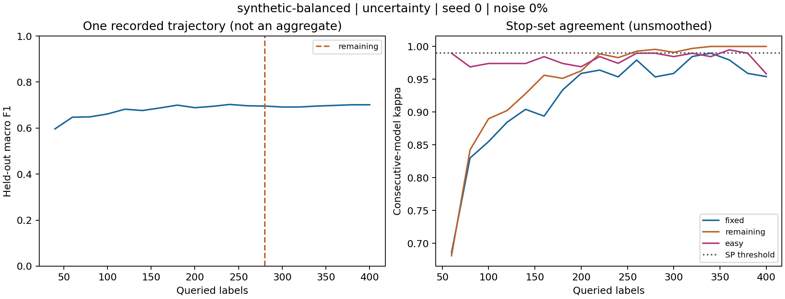

# LastLabel

**When should active learning stop asking for labels?**

LastLabel builds directly on Dr. Michael Bloodgood's research on stopping active learning and my undergraduate research with him at The College of New Jersey. His work with K. Vijay-Shanker, John Grothendieck, Michael Altschuler, and Luke Kurlandski provides the methodological foundation for this project.

The goal is to identify when a model's apparent stability is a reliable reason to stop annotation. Stopping too early can sacrifice predictive performance. Stopping too late spends time and money labeling examples that add little value. LastLabel measures that trade-off and tests where the published criteria become less reliable under noisy labels or biased stop sets.

This is a research benchmark for practitioners choosing a stopping policy and researchers testing improvements. It provides paired comparisons, auditable run records, and reusable experiments. It does not claim a new stopping algorithm or an exact reproduction of the papers' published tables.

[Methods](docs/METHODS.md) / [Study design](docs/STUDY.md) / [Pilot findings](reports/pilot/FINDINGS.md) / [Main-study findings](reports/main/FINDINGS.md) / [Budget follow-up](reports/budget/FINDINGS.md) / [Ablations](reports/ablations/FINDINGS.md) / [Failure analysis](reports/main/diagnostics/FINDINGS.md) / [Threshold sensitivity](reports/main/diagnostics/SENSITIVITY.md) / [Batch execution guide](docs/CLUSTER.md)

The active-learning engine is [small-text](https://github.com/webis-de/small-text). LastLabel adds stopping-rule evaluation, noise experiments, and auditable reports. The Python package and CLI retain the name `stoplab`.

## Independent research contributions

LastLabel is an independent empirical study building on published stopping methods and my earlier research with Dr. Michael Bloodgood. Its contribution is the experimental investigation and reproducible evaluation framework, rather than a claim to have invented SP or PCF.

- Simulated symmetric and class-conditional annotation noise, with clean held-out evaluation
- Deliberately biased easy stop sets alongside fixed and remaining-pool comparisons
- Paired estimates of annotation cost, macro F1, and positive-class F1 across tasks and seeds
- Auditable configurations, query histories, outcome checks, and label-isolation tests
- Threshold replay on saved trajectories without retraining or selecting thresholds on test results

These are contributions of this project, not claims that each experimental technique is new to the literature. The [technical report](paper/lastlabel.tex) develops the question, evidence, and limitations.

## Research summary

- **Question:** When do label-free stopping rules reduce annotation effort without materially degrading held-out predictive performance?
- **Working hypothesis:** A representative fixed stop set offers a more dependable cost/performance trade-off than a shrinking or initially easy set under annotation noise. This hypothesis is informed by Bloodgood and his coauthors' work and the exploratory pilot, not an independently preregistered claim.
- **Design:** Compare SP and PCF on shared active-learning trajectories, pairing seeds within each task, learner, query policy, and noise condition. Retain budget fallbacks. Report annotation counts and held-out macro and positive-class F1 together, with paired seed-level uncertainty and task-specific failure analyses.
- **Principal findings:** The exploratory pilot showed a possible savings/performance trade-off. In the audited main study, easy-set SP saved 114.67 labels but lost 4.00 macro-F1 percentage points in the corresponding noisy balanced-synthetic condition across 30 seeds. Paired 95% intervals were [-163.33, -62.00] labels and [-6.07, -2.03] F1 points. Several text tasks showed little or no difference. These pointwise results support task-specific interpretation, not a universal ranking.
- **Limitations:** The 96-trajectory pilot is exploratory, uses simulated noise and only three seeds per condition, and predates the small-text migration. Four text tasks in the expanded study share one corpus. New seeds do not supply new test documents. The main-study audit is complete. Paired positive-class F1 estimates and initial follow-up comparisons are available. Event-level diagnostics now distinguish early triggers from budget fallback. Mechanistic failure interpretation remains incomplete.

## Research foundation

- **Stabilizing Predictions:** Bloodgood and Vijay-Shanker, [2009](https://aclanthology.org/W09-1107/). Agreement between successive models supplies a label-free stopping signal.
- **Theory:** Bloodgood and Grothendieck, [2013](https://aclanthology.org/W13-3502/). Analysis connecting prediction stability with changes in F measure.
- **Predicted Change of F:** Altschuler and Bloodgood, [2019](https://arxiv.org/abs/1901.09118). A stopping criterion estimating changes in positive-class F measure.
- **Stop-set selection:** Kurlandski and Bloodgood, [2022](https://arxiv.org/abs/2201.05460). The basis for comparing a representative fixed stop set with the shrinking unlabeled pool.

LastLabel extends these ideas with simulated annotation noise, an initially easy stop set, matched learner comparisons, and offline threshold replay. The [study specification](docs/STUDY.md) distinguishes paper-derived methods from these extensions and explains each experimental choice. Full attribution is in [REFERENCES.md](docs/REFERENCES.md).

## Quick start

Python 3.11+ and a CPU.

```sh
git clone https://github.com/ReegoJA/lastlabel.git
cd lastlabel
python -m pip install -e .
python -m stoplab run --config configs/smoke.json --output results/smoke
python -m stoplab audit --results results/smoke
python -m stoplab report --results results/smoke --output reports/smoke
```

The smoke experiment runs offline with synthetic data. Reports measure label savings, premature stops, excess labeling, and held-out F1. Stopping decisions never use evaluation labels.

## Completed pilot

The bundled pilot contains **96 trajectories**, four binary tasks, two learners, two acquisition policies, two noise rates, and three seeds per condition. It produced 960 default-rule outcomes and 10,368 replay decisions. These reuse the same trajectories and are not independent experiments.

The central pilot observation is a potential exchange of annotation savings for lower predictive performance. In the illustrative noisy synthetic condition, easy-set SP saved 200 labels but lost 5.22 macro-F1 percentage points relative to fixed-set SP. The [findings](reports/pilot/FINDINGS.md) give paired intervals, censoring rates, and limitations. Three-seed estimates are exploratory.



```sh
python -m stoplab audit --results results/pilot
python -m stoplab replay --results results/pilot --grid configs/sensitivity.json --output reports/replay
```

The pilot predates the small-text migration. Its records and manifest are preserved. New runs use small-text 1.4.1 and require new output directories. See [implementation details](docs/METHODS.md#small-text-engine) for compatibility checks and stopping-rule differences.

## Expanded study

| Stage | Trajectories | Question |
| --- | ---: | --- |
| Robustness | 8,640 | How do stop-set effects change with learner, task, and annotation-noise mechanism? |
| Controlled ablations | 4,800 | Are differences driven by query batch size or stop-set size? |
| Budget extension | 1,920 | Does a 400-label ceiling hide later stopping behavior? |

The **15,360 planned trajectories** cover six tasks. The main stage uses 30 seeds per condition, with 20 per condition in each follow-up stage. Four text tasks come from the same 20 Newsgroups corpus, alongside two synthetic conditions. All 15,360 training trajectories completed on October 14, 2026. The 8,640-run main stage passed audit, reporting, and threshold replay. Both follow-up stages also passed audit and completed reporting and threshold replay. The [initial case study](reports/main/FINDINGS.md) includes task-specific paired estimates and explicit limitations.

The expanded experiments were run on Georgia Tech's PACE Phoenix cluster, provided by the Partnership for an Advanced Computing Environment (RRID:SCR_027619).

## Project structure

| Path | Contents |
| --- | --- |
| `stoplab/` | Data, learners, stopping rules, experiments, reports, replay, and CLI |
| `tests/` | Equations, isolation, pairing, task coverage, and artifact checks |
| `configs/` | Smoke, pilot, expanded studies, and replay specifications |
| `cluster/` | Slurm runner and bounded-array submission tool |
| `docs/` | Methods, study design, Batch execution guide, and references |
| `results/pilot/`, `reports/pilot/`, `reports/main/` | Pilot evidence and audited main-study tables |
| `paper/` | Standalone LaTeX technical report draft |
| `requirements-pilot.txt` | Original pilot environment |

## Credits and license

Created October 13, 2026 by Reego John-Annaselvan. [MIT license](LICENSE). [Release history](CHANGELOG.md). [Contributing](CONTRIBUTING.md).

Dr. Michael Bloodgood's research and my work with him are the starting point for LastLabel. The cited coauthors share credit for the underlying methods. The extensions and this implementation are my responsibility.

Uses small-text, NumPy, SciPy, scikit-learn, Matplotlib, and threadpoolctl. Development tools include pytest, YAPF, and setuptools. Maintainer and license details are in [REFERENCES.md](docs/REFERENCES.md). Raw 20 Newsgroups text is downloaded separately.
