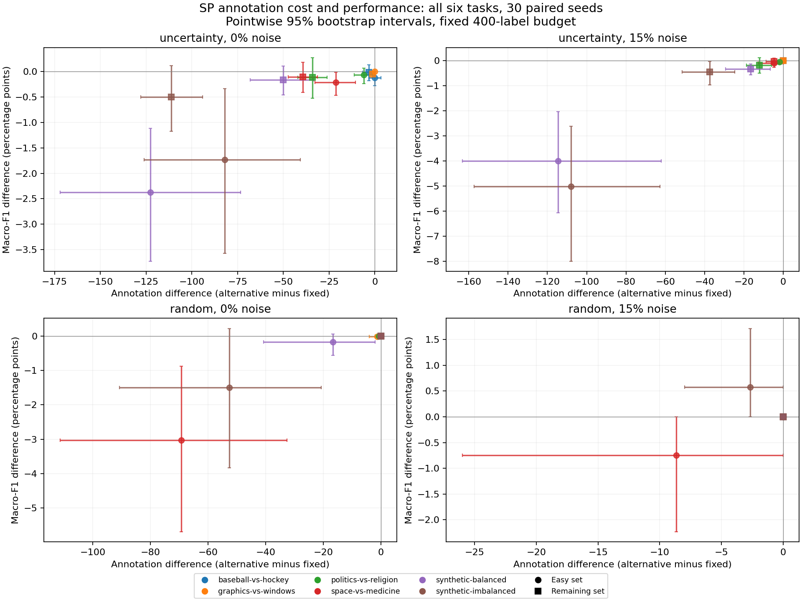

# Main study: initial findings

October 14, 2026. All 8,640 main-study trajectories passed the provenance and outcome audit. Training used the pinned source revision `7f7d2c74d018d93e2844f67317245eb5c8c3a893` and small-text 1.4.1. Manifest: `330302ae7e859d5cfc07345ce531bbf05f702a1e5e220b27ed48286977356a0c`.

## Annotation savings versus predictive performance

The question is whether fewer queried labels are worth the associated change in predictive performance. Faster stopping is not itself a success. The table below follows the pilot illustration: linear SVM, uncertainty acquisition, symmetric 15% annotation noise, SP threshold 0.99 with a three-pair window, and a 400-label ceiling. Every task is included, with 30 matched seeds per condition. This slice was chosen for continuity with the pilot, not as a separately preregistered confirmatory test.

Differences are alternative minus fixed stop set. Negative label differences mean fewer annotations. Negative F1 differences mean worse performance. Brackets are pointwise 95% percentile bootstrap intervals from 2,000 seed resamples. Macro-F1 differences are shown in percentage points. Budget fallback is retained.

| Task | Stop-set comparison | Labels, difference [interval] | Macro F1, pp [interval] |
| --- | --- | ---: | ---: |
| baseball-vs-hockey | easy minus fixed | 0.00 [0.00, 0.00] | 0.00 [0.00, 0.00] |
| baseball-vs-hockey | remaining minus fixed | 0.00 [0.00, 0.00] | 0.00 [0.00, 0.00] |
| graphics-vs-windows | easy minus fixed | 0.00 [0.00, 0.00] | 0.00 [0.00, 0.00] |
| graphics-vs-windows | remaining minus fixed | 0.00 [0.00, 0.00] | 0.00 [0.00, 0.00] |
| politics-vs-religion | easy minus fixed | -2.00 [-6.00, 0.00] | -0.04 [-0.13, 0.00] |
| politics-vs-religion | remaining minus fixed | -12.00 [-18.67, -6.00] | -0.18 [-0.49, 0.12] |
| space-vs-medicine | easy minus fixed | -4.67 [-12.67, 0.00] | -0.09 [-0.26, 0.00] |
| space-vs-medicine | remaining minus fixed | -4.67 [-8.67, -1.33] | -0.02 [-0.16, 0.10] |
| synthetic-balanced | easy minus fixed | -114.67 [-163.33, -62.00] | -4.00 [-6.07, -2.03] |
| synthetic-balanced | remaining minus fixed | -16.67 [-29.33, -6.67] | -0.33 [-0.56, -0.13] |
| synthetic-imbalanced | easy minus fixed | -108.00 [-157.33, -62.67] | -5.01 [-8.00, -2.62] |
| synthetic-imbalanced | remaining minus fixed | -37.33 [-51.33, -24.67] | -0.45 [-0.97, -0.02] |

The easy-set stress condition reduces labeling substantially on the two synthetic tasks, but those savings accompany lower macro F1. For the balanced task, the mean change is -114.67 labels and -4.00 F1 points. The corresponding intervals are [-163.33, -62.00] labels and [-6.07, -2.03] points. This is compatible with the pilot concern, but it is not a universal stop-set ranking.

The text-task differences are smaller in this slice. Baseball versus hockey and graphics versus windows have identical cost/performance outcomes between these SP stop sets. Inspect stopping coverage in the summary table before interpreting a zero difference as successful early stopping. Censoring at the same budget can produce identical outcomes.

The figure includes all six tasks under symmetric-noise SVM, both acquisition policies, and 0 and 15% noise, as declared in the interpretation plan. Each point includes 30 paired seeds. Intervals are pointwise and settings are correlated.

## Evidence and limits

- [paired.csv](paired.csv) contains the complete main-stage paired macro-F1, positive-class F1, and annotation-count comparisons, including both acquisition policies, all noise settings, learners, and tasks. [summary.csv](summary.csv) provides per-condition positive F1, macro F1, label savings, stopping coverage, retrospective performance gaps, and excess labeling with seed-level intervals.
- These intervals condition on the datasets. They are not adjusted for the many comparisons and do not establish a family-wide significance claim. Synthetic seeds also change generated data, whereas text seeds reuse the same documents.
- Training data contain simulated noise. Test labels remain clean. Four text tasks share 20 Newsgroups, which limits claims about new corpora and annotation workflows.
- The implementation extends Bloodgood and coauthors rather than reproducing their published tables exactly. The initially easy set is an exploratory stress condition.
- [Event analysis](diagnostics/FINDINGS.md), [selected trajectories](diagnostics/CASES.md), [noise interactions](interactions/FINDINGS.md), and [convention sensitivity](conventions/FINDINGS.md) complete the descriptive follow-up. The [ablation](../ablations/FINDINGS.md) and [budget-extension](../budget/FINDINGS.md) reports retain task-specific results. These analyses do not establish a causal mechanism or select thresholds against test outcomes.

## Interpretation plan

Start with the complete 30-seed symmetric-noise SVM slice at 0 and 15% noise under both query policies. Plot paired annotation change against paired F1 change by task. Report all selected conditions, including null and adverse effects. Then use the prespecified ablations and 800-label extension to investigate whether batch size, stop-set size, or budget censoring explains the observed failures. Additional training should answer a concrete unresolved question rather than enlarge the matrix for its own sake.
